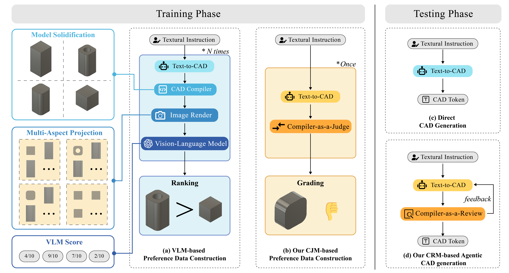
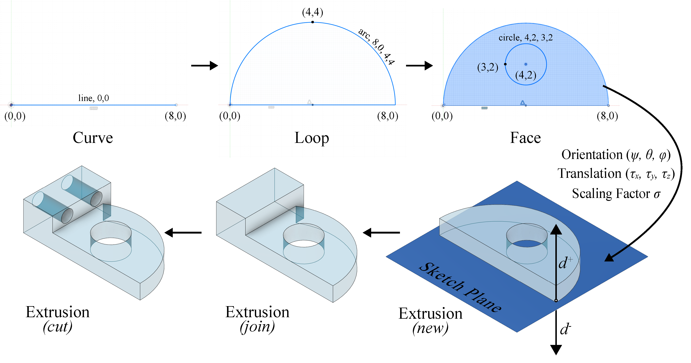
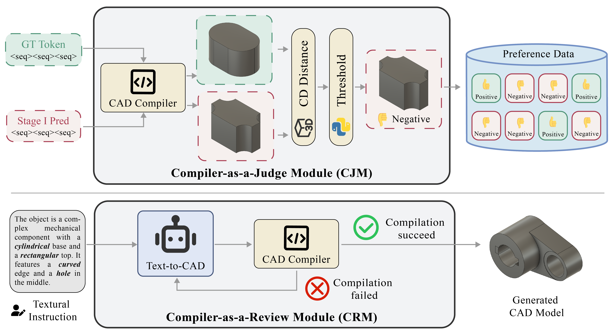
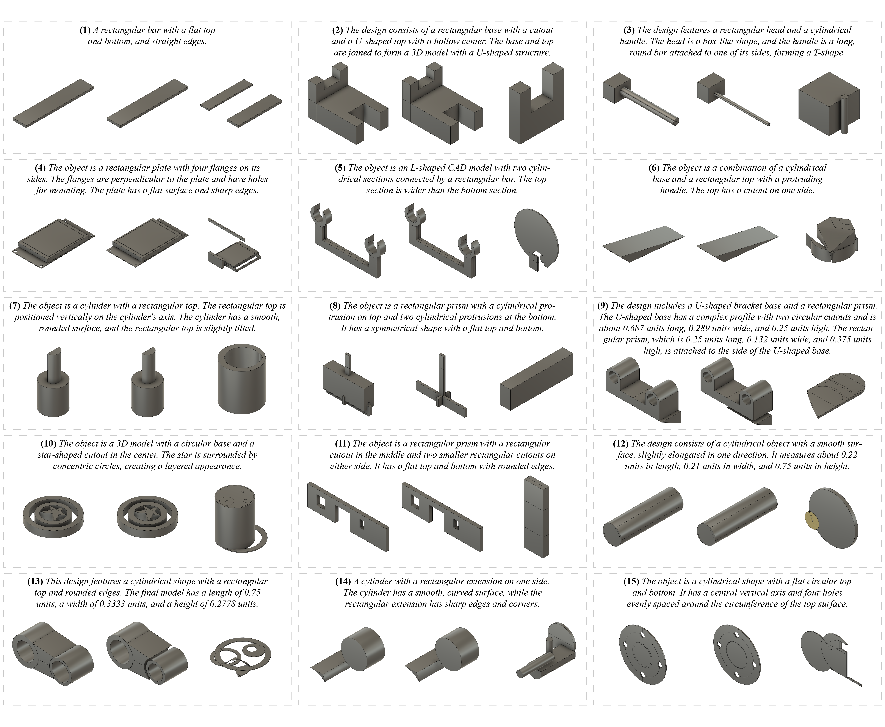

<!-- Using HTML to center the abstract -->
<div class="columns is-centered has-text-centered">
<div class="column is-four-fifths">
<h2>Abstract</h2>
<div class="content has-text-justified">
Computer-Aided Design (CAD) models are widely used across industrial design, simulation, and manufacturing processes. 
Text-to-CAD systems aim to generate editable, general-purpose CAD models from textual descriptions, significantly reducing the complexity and entry barrier associated with traditional CAD workflows. 
However, rendering CAD models can be slow, and deploying VLMs to review CAD models can be expensive and may introduce reward hacking that degrades the systems. 
To address these challenges, we propose CAD-Judge, a novel, verifiable reward system for efficient and effective CAD preference grading and grammatical validation. 
We adopt the Compiler-as-a-Judge Module (CJM) as a fast, direct reward signal, optimizing model alignment by maximizing generative utility through prospect theory. 
To further improve the robustness of Text-to-CAD in the testing phase, we introduce a simple yet effective agentic CAD generation approach and adopt the Compiler-as-a-Review Module (CRM), which efficiently verifies the generated CAD models, enabling the system to refine them accordingly. 
Extensive experiments on challenging CAD datasets demonstrate that our method achieves state-of-the-art performance while maintaining superior efficiency.
</div>
</div>
</div>

---

<!-- > Note: This is an example of a Jekyll-based project website template: [Github link](https://github.com/shunzh/project_website). -->

## Preference Data Construction



## Why Sketch-and-Extrude Helps


A CAD program in the sketch-and-extrude representation decomposes into a sequence of sketches, transforms, and extrusion operations.
This structure is what makes both **CJM** (Compiler-as-a-Judge Module) and **CRM** (Compiler-as-a-Review Module) practical:

- Each step exposes **local validity checks** to the compiler — if a sketch is not closed or an extrusion is invalid, we obtain a meaningful error signal directly from the compiler.
- The geometry can be compared **after execution**, not only at the token level, enabling a verifiable reward grounded in geometry rather than VLM proxies.
- This decomposition turns the generation problem into a sequence of locally verifiable steps, which is exactly what enables compiler-verifiable grading at training time and lightweight agentic repair at test time.


## Overview of Framework



## Visualization



## Citation
```
@inproceedings{zhou2026cadjudge,
  title={CAD-Judge: Toward Efficient Morphological Grading and Verification for Text-to-CAD Generation},
  author={Zhou, Zheyuan and Han, Jiayi and Du, Liang and Fang, Naiyu and Qiu, Lemiao and Zhang, Shuyou},
  booktitle={IEEE International Conference on Acoustics, Speech, and Signal Processing (ICASSP)},
  year={2026}
}
```